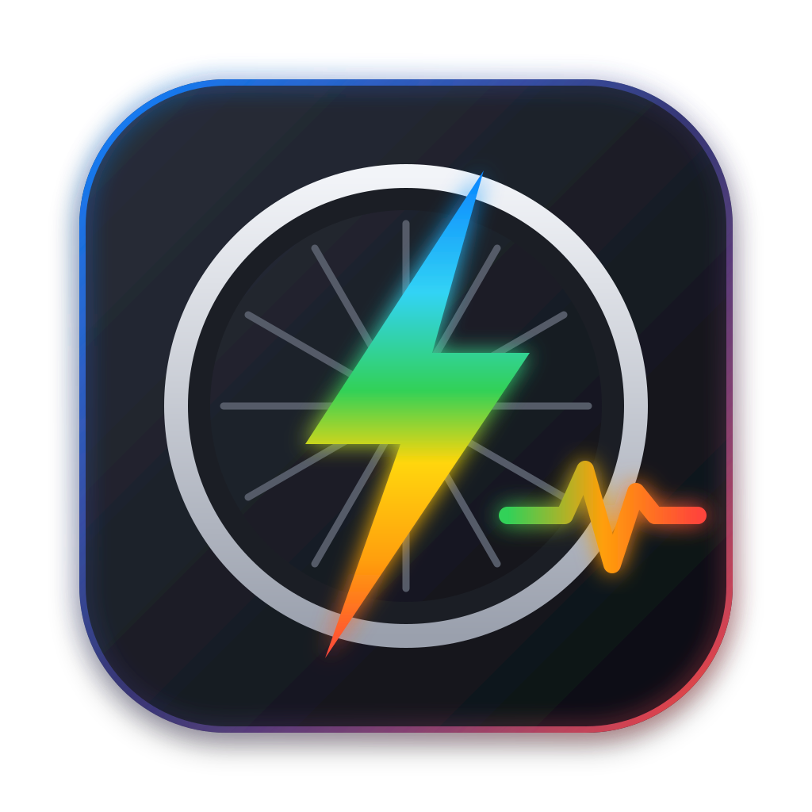
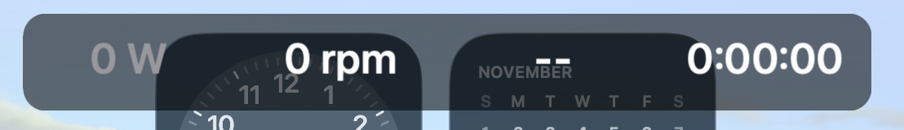

<p align="center">
  
</p>

# Ride Overlay

A small floating macOS overlay that shows live indoor-ride data — **power, cadence, heart rate and ride time** — on top of whatever you're watching: Apple TV, YouTube, Netflix, even in full screen.

It **only listens** to the ANT+ broadcasts of your trainer and heart rate strap. Whatever controls your trainer (a Garmin watch, a bike computer, …) keeps doing so; Ride Overlay never sends commands.



## Features

- Floats above full-screen video on every desktop (Space), never steals focus
- Power (3-second average), cadence, heart rate and moving time
- Power and heart rate colored by your training zones
- Menu bar icon: click-through (lock position), reset position, quit
- Remembers its position between rides
- Detects an unplugged ANT+ stick and reconnects automatically

## Requirements

- macOS
- An ANT+ USB stick: Garmin/Dynastream **ANT USB2** (`0fcf:1008`) or **ANT USB-m** (`0fcf:1009`), or a compatible clone
- An ANT+ **FE-C** smart trainer and/or an ANT+ **heart rate** strap
- Python 3.11 or later (for installing with pipx)

No Homebrew or separate libusb install is needed; the USB library ships with the package.

## Installation

### Option 1: pipx (recommended)

```bash
brew install pipx
pipx ensurepath          # then open a new terminal
pipx install git+https://github.com/andlor81/ride-overlay
```

This installs the `ride-overlay` command.

### Option 2: build the app yourself

There is no ready-made app download: distributing a signed and notarized macOS app requires a paid Apple Developer account. Building it yourself takes a few minutes and gives you a normal `Ride Overlay.app`:

```bash
git clone https://github.com/andlor81/ride-overlay.git
cd ride-overlay
python3 -m venv .venv
source .venv/bin/activate
pip install briefcase
briefcase build macOS
briefcase package macOS --adhoc-sign
```

Open the `.dmg` in `dist/` and drag **Ride Overlay** into Applications.

## Setup

### 1. Find your device numbers

With the ANT+ stick plugged in, wake up your trainer (pedal a bit) and put on your heart rate strap, then run:

```bash
pipx run openant scan
```

Note the device numbers of type **17** (your trainer, FE-C) and type **120** (heart rate). Stop with Ctrl+C.

### 2. Create your config file

```bash
mkdir -p ~/.config/ride-overlay
curl -o ~/.config/ride-overlay/config.toml \
  https://raw.githubusercontent.com/andlor81/ride-overlay/main/config.example.toml
open -e ~/.config/ride-overlay/config.toml
```

Fill in your device numbers, your FTP and your heart rate zones. The comments in the file explain each setting. Available zone colors: white, gray, blue, green, yellow, orange, red, purple, pink, teal.

## Usage

Start `ride-overlay` in a terminal, or open **Ride Overlay** from Applications if you built the app.

- **Drag** the overlay by its background to move it; it remembers the position.
- The **bicycle icon** in the menu bar has:
  - **Click-through (locks position)** — mouse clicks go to the video underneath
  - **Reset position** — back to the top-right corner
  - **Quit Ride Overlay**
- The ride timer only runs while you pedal.
- `--` means no data from that sensor for 3 seconds.

## Tips

- **Put the stick close to the trainer.** Use a USB extension cable and place the stick near the trainer with a clear line of sight, away from the Mac, USB 3 hubs and other 2.4 GHz devices.
- **Plug in only one ANT+ stick.**
- **Only one program can use the stick at a time.** Quit Garmin Express, Zwift and other training apps that use it.

## Troubleshooting

| Problem | What to do |
|---|---|
| "No ANT+ USB stick found" | Check that the stick appears in System Information → USB. Try another port or adapter. |
| "The ANT+ stick can't be opened" | Another app is using the stick. Quit Garmin Express or other training apps. |
| "Config error: …" | The message names the setting. Compare with `config.example.toml`. |
| Values flicker to `--` | Weak reception: move the stick closer to the trainer (see Tips). Check data rates with `python scripts/ant_monitor.py` from a clone of this repo. |
| Overlay is off-screen | Menu bar icon → Reset position. |

## How it works

Ride Overlay uses [openant](https://github.com/Tigge/openant) to receive ANT+ data and PyObjC to draw a native macOS window. The ANT+ receiver runs in a background thread; a timer on the main thread reads the latest values four times per second and updates the window.

openant opens device channels as *background scanning* channels by default, which deliver only about one in 13 messages. Ride Overlay opens normal tracking channels instead, for the full 4 Hz data rate.

## Development

```bash
git clone https://github.com/andlor81/ride-overlay.git
cd ride-overlay
python3 -m venv .venv
source .venv/bin/activate
pip install -e .
ride-overlay
```

- `python -m ride_overlay.overlay` shows the overlay with random demo data (no stick needed).
- `python scripts/ant_monitor.py` logs every ANT+ data page with its timing, for diagnosing reception problems.

## Disclaimer

ANT+ is a trademark of Garmin Ltd. This project is not affiliated with or endorsed by Garmin, Tacx or Apple.

## How this was built

Ride Overlay was built by Andreas Lorenz as a learning project, developed step by step in conversation with [Claude](https://claude.ai) by Anthropic. Claude wrote most of the code and explained the concepts along the way; Andreas built, tested and debugged every step on real hardware, made the design decisions, and ran the measurements that uncovered the background-scanning issue in openant.

## License

[MIT](LICENSE)
